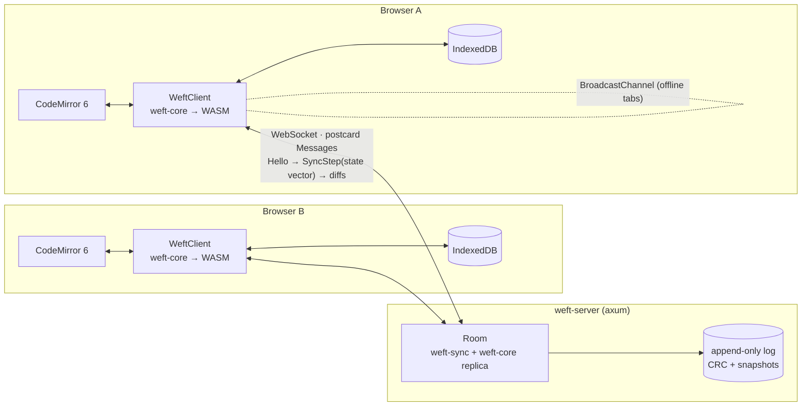

# Track 6 · Quality, DevEx & Launch

> Goal: make Weft **easy to trust, easy to try, and easy to talk about**. A stranger should be able
> to land on the repo, understand it in 30 seconds, try it in 1 click, and read *how it works* in 10
> minutes. A recruiter should be able to skim three bullets and see "distributed systems + Rust".

Back to the [roadmap index](../ROADMAP.md). Related: Docker/deploy lives in
[05-platform.md](05-platform.md); benchmarks vs Yjs/Automerge/Loro in [04-performance.md](04-performance.md).

**Testing philosophy (unchanged):** minimal, critical tests only. We are *not* adding a test suite.
CI runs what already exists (convergence proptest, random-bytes no-panic, 200-seed simulator,
smoke script), and fuzzing runs **on demand / nightly**, not on every push. Every new check here
must protect against an actual bug class we care about: divergence, a panic on untrusted bytes, a
broken build, or WASM bloat.

---

## Where we are (2026-10-25)

| Area | State |
|---|---|
| README | none |
| CI | none |
| Tests | `weft-core/tests/convergence.rs` (`replicas_converge` proptest + `random_bytes_never_panic`), `weft-sync/tests/sim.rs` (200 seeds default, 10k `--ignored`) |
| E2E | `web/scripts/smoke.mjs` (13 checks vs real server). Playwright scripts written but **not in the repo** (no `web/e2e/` on disk) |
| Benchmarks | `cargo bench -p weft-core`: automerge-perf trace 259,778 patches, local ~115 ms (~2.2M ops/s), remote ~130 ms (~2.0M ops/s) |
| WASM | 59.3 KB gzipped (148.7 KB raw), budget 150 KB gz |
| Web bundle | main JS 208 KB (70 KB gz), CSS 6 KB gz |
| Releases | none; workspace version `0.1.0`, MIT, edition 2024 |

---

## Phased plan (overview)

| Phase | What | Effort | Unlocks |
|---|---|---|---|
| **P0** | CI green on every push | 0.5–1 day | Badge, confidence, PR hygiene |
| **P1** | README + hero GIF + architecture diagram | 1–1.5 days | Anyone can understand the project |
| **P2** | Public demo URL (needs Docker from track 5) | 0.5–1 day | "Try it" link (the single biggest launch lever) |
| **P3** | Fuzzing (`cargo-fuzz`, 2 targets) | 0.5 day + nightly job | "Fuzzed decoders" claim, real robustness |
| **P4** | "How Weft works" interactive explainer | 3–5 days | The portfolio centerpiece |
| **P5** | Demo script + 90 s video | 0.5–1 day | Show HN, LinkedIn, resume link |
| **P6** | Releases (`v0.1.0`, dist binaries, changelog) | 0.5–1 day | `curl \| sh` install, version story |
| **P7** | Contributor docs | 0.5 day | Looks maintained; good-first-issues |
| **P8** | Launch (blog → Show HN → r/rust → TWiR) | 1 day writing + 1 day on call | Traffic, stars, interview stories |

Total: roughly **2 focused weeks**. P0–P2 are the critical path; do not launch without them.
P4 can ship after the first launch as a "part 2" post, which gives you a second wave.

---

## P0 · CI (GitHub Actions) — 0.5–1 day

### Design
- **One workflow, `ci.yml`, with 4 parallel jobs**: `rust`, `wasm`, `web`, `e2e` (optional).
  Keep it under ~6 min wall-clock warm.
- **Caching**: `Swatinem/rust-cache@v2` (install toolchain *before* the cache step, since the key
  includes the rustc version); `actions/setup-node` with `cache: npm` and
  `cache-dependency-path: web/package-lock.json`; Playwright browsers keyed on the Playwright version.
- **Tools via `taiki-e/install-action`** (prebuilt binaries for `wasm-pack`, `cargo-dist`, etc.; much
  faster than `cargo install`).
- **Concurrency**: cancel superseded runs on the same branch.
- **Pin a toolchain** with a root `rust-toolchain.toml` (`channel = "stable"`, `targets = ["wasm32-unknown-unknown"]`,
  `components = ["rustfmt", "clippy"]`) so local and CI agree.
- **Critical tests only**: `cargo test --workspace` already runs the proptest, the no-panic test and
  the 200-seed simulator (~3.5 s debug). The 10k-seed run (`--release --ignored`, ~26 s) goes in the
  nightly workflow, not per push.
- **WASM size budget as a gate**: fail if gzipped `.wasm` > 150 KB; print the number in the job
  summary so the trend is visible in every PR.

### Draft `.github/workflows/ci.yml`

```yaml
name: CI
on:
  push: { branches: [main] }
  pull_request:
concurrency:
  group: ci-${{ github.ref }}
  cancel-in-progress: true
env:
  CARGO_TERM_COLOR: always
  RUSTFLAGS: -D warnings

jobs:
  rust:
    runs-on: ubuntu-latest
    steps:
      - uses: actions/checkout@v6
      - uses: dtolnay/rust-toolchain@stable
        with: { components: "rustfmt, clippy" }
      - uses: Swatinem/rust-cache@v2
      - run: cargo fmt --all --check
      - run: cargo clippy --workspace --all-targets -- -D warnings
      - run: cargo test --workspace            # proptest + no-panic + 200-seed sim
      - run: cargo bench -p weft-core --no-run # benches still compile

  wasm:
    runs-on: ubuntu-latest
    steps:
      - uses: actions/checkout@v6
      - uses: dtolnay/rust-toolchain@stable
        with: { targets: wasm32-unknown-unknown }
      - uses: Swatinem/rust-cache@v2
        with: { key: wasm }
      - uses: taiki-e/install-action@v2
        with: { tool: wasm-pack }
      - run: scripts/build-wasm.sh
      - name: Size budget (150 KB gz)
        run: |
          f=$(ls web/src/wasm/pkg/*_bg.wasm)
          raw=$(stat -c%s "$f"); gz=$(gzip -9 -c "$f" | wc -c)
          echo "### WASM size: $((gz/1024)) KB gz / $((raw/1024)) KB raw" >> "$GITHUB_STEP_SUMMARY"
          test "$gz" -le 153600 || { echo "::error::WASM $gz B gz > 150 KB budget"; exit 1; }
      - uses: actions/upload-artifact@v4
        with: { name: wasm-pkg, path: web/src/wasm/pkg }

  web:
    needs: wasm
    runs-on: ubuntu-latest
    defaults: { run: { working-directory: web } }
    steps:
      - uses: actions/checkout@v6
      - uses: actions/download-artifact@v4
        with: { name: wasm-pkg, path: web/src/wasm/pkg }
      - uses: actions/setup-node@v4
        with: { node-version: 22, cache: npm, cache-dependency-path: web/package-lock.json }
      - run: npm ci
      - run: npm run build                     # tsc --noEmit && vite build
      - uses: actions/upload-artifact@v4
        with: { name: web-dist, path: web/dist }

  e2e:                                         # optional: smoke always, Playwright when present
    needs: [rust, web]
    runs-on: ubuntu-latest
    steps:
      - uses: actions/checkout@v6
      - uses: dtolnay/rust-toolchain@stable
      - uses: Swatinem/rust-cache@v2
      - uses: actions/download-artifact@v4
        with: { name: web-dist, path: web/dist }
      - uses: actions/setup-node@v4
        with: { node-version: 22, cache: npm, cache-dependency-path: web/package-lock.json }
      - run: cd web && npm ci
      - run: cargo build --release -p weft-server
      - run: |
          ./target/release/weft-server & echo $! > server.pid
          npx --yes wait-on http://127.0.0.1:7878/healthz   # use the port from weft-server's config.addr
          node web/scripts/smoke.mjs
      - if: hashFiles('web/e2e/**') != ''
        run: cd web && npx playwright install --with-deps chromium && npm run e2e
```

### Nightly workflow (`nightly.yml`, `schedule: cron "0 6 * * *"` + `workflow_dispatch`)
- `cargo test -p weft-sync --release -- --ignored` (10k seeds).
- `PROPTEST_CASES=2000 cargo test -p weft-core --release` (deeper convergence run).
- Fuzz both targets for 5 min each (P3); upload `fuzz/artifacts/**` on failure.
- On failure, auto-open an issue (`gh issue create` or `peter-evans/create-issue-from-file`).

### Checklist
- [ ] Add `rust-toolchain.toml` (stable + wasm32 + rustfmt/clippy) — 10 min
- [ ] `ci.yml` jobs `rust`, `wasm`, `web` green — 2–3 h
- [ ] WASM size gate + step summary — 30 min
- [ ] Commit Playwright scripts to `web/e2e/`, add `"e2e": "playwright test"` script, keep it optional — 1 h
- [ ] `e2e` job (smoke always, Playwright if present) — 1–2 h (port/ready-wait is the fiddly part)
- [ ] `nightly.yml` (10k seeds, deeper proptest, fuzz) — 1 h
- [ ] Dependabot for `cargo`, `npm`, `github-actions` (monthly, grouped) — 15 min
- [ ] Branch protection: require `rust`, `wasm`, `web` — 5 min
- [ ] CI badge in README

---

## P3 · Fuzzing (`cargo-fuzz`) — 0.5 day + nightly

Why: the server accepts **untrusted bytes** from every WebSocket. `random_bytes_never_panic` covers
uniform noise; coverage-guided fuzzing finds the structured edge cases (huge varint lengths,
client-table indices out of range, deep pending queues) that random bytes almost never hit. This is
also a strong interview talking point ("the decoders are fuzzed; here is the bug it found").

Setup: `cargo install cargo-fuzz`, needs **nightly** (`cargo +nightly fuzz run …`). `cargo fuzz init`
creates a separate `fuzz/` crate; exclude it from the workspace (`exclude = ["fuzz"]` in root
`Cargo.toml`) so stable builds are unaffected.

### Targets

```rust
// fuzz/fuzz_targets/apply_update.rs
#![no_main]
use libfuzzer_sys::fuzz_target;
use weft_core::{Doc, Update};

fuzz_target!(|data: &[u8]| {
    // 1) Untrusted bytes must decode-or-error, never panic.
    let Ok(update) = Update::decode(data) else { return };
    // 2) Applying a decodable update must never panic, and re-applying is idempotent.
    let mut doc = Doc::new(1);
    if doc.apply_update(&update).is_ok() {
        let text = doc.text();
        let _ = doc.apply_update(&update);
        assert_eq!(text, doc.text(), "apply_update not idempotent");
        // 3) Round trip: full state (Update -> bytes -> Update) reproduces the text on a fresh replica.
        let bytes = doc.encode_full().encode();
        let mut b = Doc::new(2);
        b.apply_update(&Update::decode(&bytes).unwrap()).unwrap();
        assert_eq!(doc.text(), b.text());
    }
});
```

```rust
// fuzz/fuzz_targets/message_decode.rs
#![no_main]
use libfuzzer_sys::fuzz_target;
use weft_sync::Message;

fuzz_target!(|data: &[u8]| {
    if let Ok(msg) = Message::decode(data) {
        // Strict decode: encode(decode(x)) must decode to the same value.
        let again = Message::decode(&msg.encode()).expect("re-decode");
        assert_eq!(format!("{msg:?}"), format!("{again:?}"));
    }
});
```

(Names match the current API as of writing: `Doc::new(ClientId)`, `Doc::text()`, `Doc::encode_full() -> Update`,
`Update::{encode, decode}`, `Message::{encode, decode}`; `Message` may need `PartialEq` or the
`Debug` comparison above.)

A stronger third target (optional) uses `arbitrary` to generate *valid* edit sequences on 3 replicas
and asserts convergence, i.e. a coverage-guided version of the proptest.

### Checklist
- [ ] `cargo fuzz init`, exclude `fuzz/` from workspace — 15 min
- [ ] `apply_update` target + seed corpus (encode a few real updates from the bench trace into `fuzz/corpus/apply_update/`) — 1 h
- [ ] `message_decode` target + corpus (one of each `Message` variant) — 45 min
- [ ] Run each ≥ 30 min locally; fix and **write down** anything found (great blog material) — 1–2 h
- [ ] Nightly CI: `cargo +nightly fuzz run <t> -- -max_total_time=300`; upload crashes as artifacts — 30 min
- [ ] Each crash found becomes a one-line regression input in `random_bytes_never_panic` (no new test files)
- [ ] (Later) OSS-Fuzz is overkill; skip.

---

## P1 · README — 1–1.5 days

The README is the landing page. Order matters: **show, then tell, then prove**.

### Ready-to-use outline (`README.md`)

```markdown
<p align="center"></p>

# Weft

**Real-time collaborative Markdown, offline-first and conflict-free, in full-stack Rust.**
One CRDT engine runs in your browser (WASM, 59 KB gz) *and* on the server.

[**Try it →**](https://weft.example.dev) · [How it works](https://weft.example.dev/how) · [Blog post](…) · 

## Why (30 seconds)
- **Instant:** open a link and type. No account, no spinner.
- **Offline-first:** every keystroke lands in IndexedDB first. Reconnect and it merges.
- **Conflict-free by construction:** a sequence CRDT (FugueMax) means replicas that saw the same
  ops show the same text, in any delivery order.
- **Same code everywhere:** `weft-core` compiles to `wasm32` and native. The server is just another replica.

## Numbers
| Metric | Result |
|---|---|
| automerge-perf trace (259,778 edits), local apply | ~115 ms (~2.2M ops/s) |
| same trace, remote apply | ~130 ms (~2.0M ops/s) |
| Full doc state after trace | 434 KB |
| WASM bundle | 59.3 KB gzipped |
| Keystroke → other browser (localhost) | 2–7 ms |
| Simulated faulty networks that converge | 10,000 / 10,000 seeds |
| `kill -9` server → clients resync | ~60 ms, no loss |
<sub>Machine, rustc version, command: `cargo bench -p weft-core`.</sub>

## Architecture
(diagram, see below)

## How it works (2-minute version)
1. Every character has an ID `(client, clock)`; inserts remember left and right origins (FugueMax).
2. A **state vector** `client → next clock` names a version. Sync = swap vectors, send the diff.
3. The protocol (`weft-sync`) is **sans-IO**, so a deterministic simulator can drop, duplicate,
   reorder, and partition messages, and crash the server, across 10k seeds.
4. The server keeps an append-only, CRC-checked log per doc, compacts to snapshots with
   fsync + atomic rename, and truncates torn tails on recovery.
→ Long version with live visualizations: **How Weft works**.

## Features
Live cursors · presence · offline mode with an honest sync pill · time-travel scrubber ·
live-styled Markdown · ⌘K palette · focus mode · share + QR · `.md` export · PWA

## Run it locally
​```sh
rustup target add wasm32-unknown-unknown && cargo install wasm-pack
scripts/dev.sh                 # server + Vite, opens http://localhost:5173
# or a production build:
scripts/build-wasm.sh && (cd web && npm ci && npm run build) && cargo run --release -p weft-server
​```
`curl localhost:7878/api/docs/<id>/export.md`

## Repo layout
| Crate / dir | Role |
| `crates/weft-core` | CRDT engine (no deps on IO) |
| `crates/weft-sync` | sans-IO protocol, `ClientSession`, `Room`, simulator |
| `crates/weft-server` | axum server, `DocStore` log + compaction |
| `crates/weft-wasm` | wasm-bindgen `WeftClient` |
| `web/` | Vite + TypeScript + CodeMirror 6 UI |

## Testing (deliberately small)
Convergence proptest · random-bytes no-panic · 10k-seed network simulator · fuzzed decoders · smoke + Playwright E2E.

## Prior art & thanks
Yjs/YATA, Fugue (Weidner & Kleppmann), Seph Gentle's diamond-types and the automerge-perf trace, Loro, Automerge.

## License
MIT
```

### Architecture diagram
Use a **Mermaid** block (renders natively on GitHub, diffable) and export one SVG for the blog.



### Hero GIF recipe
- 2 Chromium windows side by side, 1280×720 total, light theme, big font (zoom 125%).
- Script (≤ 12 s, loops): A types a heading → B's cursor appears → both type in the same line →
  A toggles DevTools "Offline" (pill: *Offline · 8 unsynced edits*) → both keep typing → A back online →
  texts snap to identical → quick scrub of the history panel.
- Record with Playwright `video: 'on'` (repeatable, reshootable after UI changes) or OBS; convert
  with `ffmpeg … -vf "fps=15,scale=720:-1:flags=lanczos,palettegen"` + `paletteuse`. Target < 3 MB.
  Also keep an MP4 (GitHub plays `<video>` from uploaded assets) for higher quality.

### Checklist
- [ ] Record hero GIF (scripted with Playwright so it can be re-shot) — 2–3 h
- [ ] Mermaid architecture diagram + SVG export — 1 h
- [ ] Re-run benches on a named machine; fill the Numbers table with command + hardware — 1 h
- [ ] Write README per outline (≤ 1 screen before the fold) — 2–3 h
- [ ] 2 static screenshots (dark mode, history scrubber) in `docs/media/` — 30 min
- [ ] Repo polish: description, topics (`rust`, `crdt`, `wasm`, `collaborative-editing`, `axum`, `local-first`), social preview image (1280×640) — 30 min

---

## P2 · Public demo — 0.5–1 day (depends on track 5 Dockerfile)
- [ ] Multi-stage Dockerfile (rust builder → wasm-pack → node build → distroless/debian-slim runtime with `web/dist`) — see 05-platform
- [ ] Deploy (Fly.io / a small VPS) with a persistent volume for the doc log
- [ ] Launch-day hardening: per-IP connection cap, max doc size, max message size, idle doc unload
      (exists), a `robots.txt`, and a banner "docs are public to anyone with the link"
- [ ] A **seeded demo doc** (`/d/welcome`) that explains the app in itself, plus a nightly reset job
- [ ] Uptime check on `/healthz` (free tier of any pinger); `/api/stats` for a live "N docs, M peers" counter
- [ ] "Open in two tabs" button on the landing state, because most visitors are alone

---

## P4 · "How Weft works" interactive explainer — 3–5 days

The portfolio centerpiece. Inspiration: Bartosz Ciechanowski's explainers, Seph Gentle's CRDT posts,
the Fugue paper figures, "An Interactive Intro to CRDTs" (jakelazaroff). Lives at `/how` in the same
Vite app (or `docs/site/`), and **uses the real `weft-core` WASM**, not a JS re-implementation. That's
the whole point: the explainer is driven by the production engine.

### Sections (each one a live widget)
1. **Three replicas, one doc.** Three mini editors (A, B, C) with a per-link "network" toggle
   (connected / delayed / partitioned). Type in each; watch them diverge while partitioned and snap
   together on heal.
2. **Every character has an ID.** Hover a char → tooltip `(client 7, clock 42)`, left/right origin
   arrows drawn as SVG. Tombstones shown greyed when "show deleted" is on.
3. **State vectors.** Live table `client → next clock` for each replica, with cells highlighting
   when they advance. A "sync A↔B" button animates: exchange SVs → compute diff → bytes on the wire
   (show size) → apply.
4. **Concurrent inserts at the same spot.** A scripted race ("A types `cat`, B types `dog` at the same
   position"), then show *why* FugueMax doesn't interleave (`cdaotg` vs `catdog`). A toggle to a naive
   algorithm shows the interleaving anomaly.
5. **Out-of-order delivery.** Drag message envelopes into a different order; the pending queue fills
   and drains visibly.
6. **The simulator.** Pick a seed, run 1 scenario in the browser at slow speed with a timeline of
   drops/dups/partitions/crash, end with a green ✓ "converged". Then "Run 1,000 seeds" in a Web Worker.
7. **Crash safety.** Animated log: records appended, a torn write, recovery truncates the tail.
8. **Binary format.** Hex view of an update with byte ranges colored (version, client table,
   zigzag-delta clocks, varints).

### Implementation notes
- Expose a few read-only debug methods from `weft-wasm` behind a cargo feature `explain`
  (`items()` → `[ {id, origin_left, origin_right, deleted, text} ]`, `state_vector_json()`,
  `pending_len()`) so the production bundle stays at 59 KB.
- Rendering: plain SVG + TS; no framework needed. Respect `prefers-reduced-motion`.
- Each widget has a "reset" and a permalink to its state (`#sv?ops=…`), handy for sharing in interviews.

### Checklist
- [ ] `explain` feature + 3 debug exports in `weft-wasm` — 2–3 h
- [ ] Widgets 1–3 (replicas, IDs, state vectors) — 1.5 days (MVP: launch with these)
- [ ] Widgets 4–5 (interleaving, out-of-order) — 1 day
- [ ] Widgets 6–8 (simulator, crash, hex) — 1–1.5 days (good "part 2" post)
- [ ] Prose pass: ≤ 2,500 words, one idea per widget — 0.5 day
- [ ] Link from README, app's ⌘K ("How Weft works"), and the blog post

---

## P5 · Demo script & video — 0.5–1 day

### 90-second demo script (also your live interview demo)
| t | Action | Voice-over |
|---|---|---|
| 0:00 | Landing, press `/` → new doc | "Weft is a collaborative Markdown editor. No account: a new doc is one keystroke." |
| 0:08 | Share → open link in 2nd window; cursors appear | "Second browser joins. Every keystroke is a CRDT op, under 10 ms locally." |
| 0:20 | Both type in the same sentence | "Concurrent edits never conflict; the merge is deterministic." |
| 0:30 | DevTools Offline on A; pill shows unsynced count; both type | "A goes offline. Edits land in IndexedDB. The pill tells the truth: 14 unsynced edits." |
| 0:45 | Back online → identical | "Reconnect: they swap state vectors, send only the diff, converge." |
| 0:55 | Terminal: `kill -9` server, restart; clients show Reconnecting → Live | "Kill the server mid-session. The checksummed log recovers; clients resync in ~60 ms." |
| 1:08 | History scrubber plays the doc from empty | "Every op has an ID, so time travel is free." |
| 1:18 | Split: `cargo test` sim output / architecture diagram | "Same Rust crate in the browser and the server, tested against 10,000 simulated faulty networks." |
| 1:28 | Logo + URL | "Try it at … Code on GitHub." |

### Checklist
- [ ] Rehearse the script 3× against the live demo; fix any rough spot found — 1 h
- [ ] Record at 1080p (OBS), voice-over separately, captions burned in (most people watch muted) — 2–3 h
- [ ] Upload to YouTube (unlisted is fine) + MP4 in the release; 15 s vertical cut for LinkedIn — 1 h
- [ ] Keep a **local offline fallback** of the demo for interviews (no Wi-Fi dependency; fittingly)

---

## P6 · Versioning & releases — 0.5–1 day

- **SemVer, one workspace version** (`[workspace.package] version`). Pre-1.0: minor bumps may break the
  wire format; the `Update` version byte (now v2) and `Message` protocol version are documented in
  `docs/ARCHITECTURE.md` and bumped **independently** of the crate version.
- **Changelog**: `CHANGELOG.md` in Keep-a-Changelog style, written by hand (it's short), or
  `git-cliff` from Conventional Commits if you prefer automation.
- **`dist` (formerly cargo-dist)** for `weft-server` binaries: `dist init` → generates
  `.github/workflows/release.yml`; pushing tag `v0.1.0` builds Linux x86_64/aarch64, macOS
  arm64/x86_64, and Windows, uploads to a GitHub Release with a shell/PowerShell installer.
  - **Gotcha:** the server serves `web/dist` from disk. For a single self-contained binary, embed the
    built assets (`rust-embed` or `include_dir`) behind a cargo feature `embed-web`, and have the
    release workflow build the web app before `dist build` (dist supports custom build setup steps).
  - Also publish the Docker image to GHCR on tags (track 5).
- **crates.io**: optional. `weft-core` is a nice standalone crate (name may be taken; check
  `weft-crdt`). Only publish once the API is something you'd support; otherwise skip.
- **npm**: skip; the WASM pkg is internal.

### Checklist
- [ ] `CHANGELOG.md` with a `0.1.0` entry summarizing M0–M6 — 30 min
- [ ] `embed-web` feature so `weft-server` is one binary — 1–2 h
- [ ] `dist init` + release workflow; dry-run on a `v0.1.0-rc.1` tag — 1–2 h
- [ ] Tag `v0.1.0` the day before launch; release notes link the blog post and demo
- [ ] Document protocol/format versioning rules in ARCHITECTURE.md — 20 min

---

## P7 · Contributor docs — 0.5 day
- [ ] `CONTRIBUTING.md`: prerequisites, `scripts/dev.sh`, the 4 CI commands to run before a PR
      (`fmt`, `clippy`, `test`, `npm run build`), the minimal-tests policy and *when* a test is
      warranted (divergence, panic on untrusted input, data loss), how to run the 10k sim and fuzzers.
- [ ] Point to `docs/ARCHITECTURE.md` for contracts and to `PLAN.md` / `ROADMAP.md` for open work.
- [ ] `.github/ISSUE_TEMPLATE/` (bug with "doc id + browser + steps", feature) and a short PR template.
- [ ] 5–8 `good first issue`s from the roadmap (reduced-motion, a palette command, a phone layout fix,
      a fuzz corpus entry, a docs typo pass).
- [ ] `CODE_OF_CONDUCT.md` (Contributor Covenant) and `SECURITY.md` ("email me; the demo is public, no secrets").
- [ ] Optional: `CLAUDE.md` already exists; mention AI-assisted development honestly in CONTRIBUTING
      if asked about it in interviews (be ready to explain every design decision yourself).

---

## P8 · Launch plan — 1 day writing + launch day

### Order and timing
1. **T-7 days:** CI green, README done, demo deployed, `v0.1.0` RC tested, explainer widgets 1–3 live.
   Ask 3–5 friends/classmates to try the demo and break it; fix what they find.
2. **T-1:** Tag `v0.1.0`. Publish the blog post (own site / dev.to / Hashnode; canonical on your site).
3. **Launch day (Tue–Thu, ~8–10 am US Eastern):** Show HN. Stay at the keyboard for 4–6 hours and
   answer every comment (technical, humble, specific numbers). Keep a scratch doc of questions.
4. **Same day, a few hours later:** r/rust post (link the blog post, not just the repo; r/rust likes
   the "how" more than the "what").
5. **Submit to This Week in Rust** (PR to `rust-lang/this-week-in-rust`, "Project/Tooling Updates" or
   "Observations/Thoughts" section, linking the blog post) before the Tuesday cutoff.
6. **Following days:** r/programming (only if HN went well), Lobsters (needs an invite; tag `rust`,
   `distributed`), the Rust users forum ("Show and tell"), the local-first community (Discord, the
   localfirst.fm folks), LinkedIn + the 15 s video, Northeastern CS Slack/Discord channels.
7. **T+2 weeks:** "Part 2" post (explainer widgets 4–8, or the benchmark comparison from track 4) →
   second wave.

### Blog post: "Building a CRDT editor in full-stack Rust"
Outline (~2,500–3,500 words, 3–4 diagrams, 1 GIF):
1. Hook: the GIF + "One Rust crate runs in the browser and on the server; here's what that buys you."
2. Why CRDTs over OT for an offline-first editor (one paragraph, link Kleppmann).
3. The data model: IDs, origins, FugueMax, run-length items, UTF-16 lengths (and why UTF-16:
   CodeMirror/JS strings).
4. Making it fast: chunked list with cached lengths, per-client BTreeMap index, cursor cache; the
   automerge-perf trace numbers; what didn't work.
5. Wire format v2: zigzag-delta clocks, −19% size; 434 KB for the full trace.
6. Sans-IO sync + the deterministic simulator. **The bug story**: seed 2450 found a trimmed-delete
   clock bug; how the proptest was extended with merged batches so it catches it too. (This is the
   most interesting section. Lead with it in the HN comment.)
7. Durability: append-only CRC log, compaction with fsync + atomic rename, torn tails, `kill -9` demo.
8. WASM: 59 KB gz, opt-level s, wasm-opt; the JS↔WASM boundary for change events.
9. The web app: CodeMirror collab extension without echo, IndexedDB, honest sync pill.
10. What I'd do next (multi-node gossip, E2EE) + links.

### Show HN draft
**Title options** (≤ 80 chars, no superlatives, no "I made"):
- `Show HN: Weft – Offline-first collaborative Markdown editor, CRDT in Rust and WASM`
- `Show HN: Weft – A real-time Markdown editor with one Rust CRDT in browser and server`

**Text:**
> Hi HN, I'm a student at Northeastern and I built Weft to learn distributed systems properly.
> It's a real-time collaborative Markdown editor: open a link and type, no account. It keeps
> working offline and merges when you reconnect.
>
> The interesting part is that one Rust crate (`weft-core`, a FugueMax sequence CRDT) compiles to
> WASM for the browser (59 KB gzipped) and runs natively on the axum server, so both sides run
> identical merge logic. The server is just another replica that persists an append-only,
> checksummed log.
>
> Some numbers: it replays the automerge-perf editing trace (260k edits) in ~115 ms natively.
> The sync protocol is sans-IO, which let me write a deterministic network simulator (drops,
> duplicates, reordering, partitions, server crash + restart) that passes 10k random seeds. Seed
> 2450 found a real bug in how trimmed deletes tracked clocks, which I wrote up in the post.
>
> Demo: <url> (docs are public to anyone with the link, so please don't paste secrets)
> How it works, with live visualizations driven by the real WASM engine: <url>/how
> Code (MIT): <github url>
>
> I'd love feedback on the CRDT implementation and the sync protocol, and on anything that
> breaks when you try it.

**Prep for likely questions:** Why not just use Yjs/Yrs/Loro? (learning + full control; numbers vs
them in track 4) · OT vs CRDT · tombstone growth / GC · memory per doc · what happens with 100 peers ·
auth/permissions (non-goal, link = capability) · E2EE plans · interleaving anomalies (FugueMax) ·
was AI used (answer honestly and specifically).

### r/rust post draft
**Title:** `Building a collaborative editor where the same CRDT crate runs in WASM and on an axum server`
**Body:** 3–4 sentences + the GIF + the blog link + "things I'd love Rust-specific feedback on:
the chunked RLE store, the wasm-bindgen boundary, and the sans-IO design." Flair: *project*.

### Resume bullets (pick 3)
- **Weft — real-time collaborative Markdown editor (Rust, WASM, axum, TypeScript)** · github.com/… · live demo
- Built a sequence CRDT (FugueMax) in Rust that compiles to both WebAssembly (59 KB gzipped) and
  native, replaying a 260k-edit real-world trace at ~2.2M ops/s.
- Designed a sans-IO sync protocol using state-vector delta exchange, and verified convergence with a
  deterministic network simulator (drops, reordering, partitions, server crashes) across 10,000
  seeded scenarios, which surfaced and fixed a clock-tracking bug.
- Implemented a crash-safe axum WebSocket server with an append-only, CRC-checksummed log, snapshot
  compaction (fsync + atomic rename), and torn-write recovery; clients resync ~60 ms after `kill -9`.
- Shipped an offline-first web client (CodeMirror 6, IndexedDB, PWA) with live cursors, presence,
  and a time-travel history scrubber; 2–7 ms keystroke propagation between browsers.
- Set up CI (fmt, clippy, property tests, WASM size budget, Playwright E2E) and coverage-guided fuzzing
  of all untrusted-input decoders. *(only once P0/P3 are done)*

### Interview talking points (STAR-ready)
- **"Tell me about a hard bug."** Seed 2450: symptom (divergence after a specific fault pattern),
  how deterministic seeds made it reproducible, root cause (trimmed delete clock), verifying the fix by
  reintroducing the bug, and making the proptest catch the whole class.
- **"Why a CRDT?"** Offline-first and server-as-replica; trade-offs vs OT (metadata/tombstones vs a
  central transform server); why FugueMax avoids interleaving.
- **Performance:** O(n) → chunked list + cached lengths + cursor cache; measured with a real trace,
  not microbenchmarks. Binary format v2 (−19%).
- **Durability:** what fsync + rename guarantees and what it doesn't; torn tails; why checksums.
- **Testing philosophy:** few, high-leverage tests (property + simulation + fuzz) instead of many
  example tests. Be able to defend it.
- **System design follow-ups:** how you'd scale to many nodes (CRDT makes gossip safe; doc-sharding;
  see track 1), auth, abuse limits, E2EE with the key in the URL fragment.
- Have the demo, the explainer, and the simulator output ready to screen-share in < 30 s.

### Launch checklist
- [ ] Blog post written, reviewed by 1 person, diagrams exported — 1 day
- [ ] Demo load-checked (100 concurrent sockets via `examples/ws_client.rs` in a loop) — 1 h
- [ ] Show HN posted, comments answered for 4–6 h
- [ ] r/rust post
- [ ] TWiR PR submitted
- [ ] LinkedIn post + 15 s video; resume and portfolio updated with the 3 bullets
- [ ] Post-launch: triage issues within 48 h, write a short "what I learned from launching" note

---

## Risks & mitigations
| Risk | Mitigation |
|---|---|
| Demo gets abused (spam, huge docs) on launch day | size/connection limits, nightly reset of `/d/welcome`, a kill-switch env var for new-doc creation |
| Demo goes down under HN traffic | static assets via CDN or long cache headers, health check + auto-restart, test 100 sockets first |
| CI flakes (e2e timing) | e2e job optional/non-required; smoke script retries ready-wait; Playwright `retries: 1` in CI only |
| Fuzzing becomes a time sink | 2 targets only, 5 min nightly; fix crashes, don't chase coverage |
| Explainer scope creep | ship widgets 1–3 for launch, the rest is "part 2" |
| Benchmark numbers challenged | publish hardware, command, trace source; compare honestly (track 4) |

## Definition of done for this track
- [ ] Green CI badge; WASM size printed on every PR
- [ ] README with GIF, diagram, numbers, try-it link
- [ ] Public demo that survives a launch
- [ ] Two fuzz targets running nightly
- [ ] `v0.1.0` GitHub Release with binaries
- [ ] Explainer live (≥ 3 widgets) and a published blog post
- [ ] Posted to Show HN, r/rust, TWiR; resume updated

## References
- Swatinem/rust-cache (install toolchain before the cache step; `key`/`shared-key` inputs): https://github.com/Swatinem/rust-cache
- actions-rust-lang/setup-rust-toolchain (alternative with problem matchers + built-in caching): https://github.com/actions-rust-lang/setup-rust-toolchain
- taiki-e/install-action: https://github.com/taiki-e/install-action
- cargo-fuzz book: https://rust-fuzz.github.io/book/cargo-fuzz.html
- dist (cargo-dist): https://opensource.axo.dev/cargo-dist/
- This Week in Rust submissions: https://github.com/rust-lang/this-week-in-rust
- Show HN guidelines: https://news.ycombinator.com/showhn.html
- Prior art for explainers: jakelazaroff.com "An Interactive Intro to CRDTs"; Seph Gentle, "5000x faster CRDTs"; Weidner & Kleppmann, "The Art of the Fugue"
